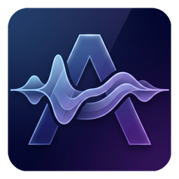

<div align="center">



# Audify

**Copy text. Hear it instantly.**

A lightweight Windows tray app that reads your clipboard aloud with natural Microsoft Edge Neural voices.

[](https://github.com/Yeamin-Sheikh/Audify/releases/latest)
[](https://github.com/Yeamin-Sheikh/Audify/releases)


[**Download**](https://github.com/Yeamin-Sheikh/Audify/releases/latest) ·
[Features](#features) ·
[Voices](#voices) ·
[Usage](#usage) ·
[Build from source](#build-from-source) ·
[Changelog](#changelog)

</div>

---

## Why Audify?

Reading long answers, docs and emails gets tiring. With Audify you **just press `Ctrl+C`** and it starts
talking in under a second, without opening an app or clicking a button. It sits quietly in the system
tray, understands Markdown and code, and knows how to say developer jargon properly
`__init__.py`, `GPT-4o`, `C#`, `k8s`, `TL;DR`.

## Features

<table>
<tr>
<td width="50%" valign="top">

### Hands-free reading
- **Copy to listen**: `Ctrl+C`, `Ctrl+X`, `Ctrl+Shift+C`, or `Ctrl+Insert` text and it is read aloud right away.
- **Sub-second start**: persistent DNS/SSL caching, token pre-warming, and 50ms streaming decode blocks start audio in **~0.4 to 0.7 seconds**.
- **Gapless playback**: concurrent chunk prefetching buffers the next paragraph while the current one plays.
- **Wispr Flow proof**: ignores clipboard changes you did not make yourself.

</td>
<td width="50%" valign="top">

### Natural neural voices
- **17 Microsoft Neural voices**: American and British female and male voices, including multilingual models (`Emma`, `Ava`, `Andrew`, `Brian`).
- **Zero CPU synthesis load**: all synthesis runs on Microsoft's neural endpoint with minimal local RAM (~45 MB).
- **8 speeds, changeable mid-sentence**: from `0.5x` to `3.0x`, resuming immediately from the sentence you are on.
- **Weekly update checks**: automatically checks PyPI weekly for `edge-tts` protocol updates.

</td>
</tr>
<tr>
<td width="50%" valign="top">

### Speaks developer
- **~580 built-in pronunciations** for code, AI, cloud and Windows terms.
- **Your own dictionary**: add, search and edit rules in the Control Center.
- **Code aware**: skips fenced code blocks and reads inline code properly.
- **Smart matching**: `IT` the acronym never touches the word "it".

</td>
<td width="50%" valign="top">

### Light and dependable
- **~27 MB portable build** with no bulky local ONNX models required.
- **Global stop hotkey** `Ctrl+Alt+S` stops everything instantly.
- **Fails fast offline** and never misses a copy while another app holds the clipboard.
- **Crash-safe settings** with automatic backup.

</td>
</tr>
</table>

## Voices

| Group | Voices |
|---|---|
| **American Female** | Jenny, Emma Multilingual, Ava Multilingual, Aria, Michelle, Ana |
| **British Female** | Sonia, Libby |
| **American Male** | Andrew Multilingual, Brian Multilingual, Christopher, Guy, Steffan, Eric, Roger |
| **British Male** | Ryan, Thomas |

## Installation

### Installer

1. Download **`Setup_Audify_2.9.11.exe`** from the [latest release](https://github.com/Yeamin-Sheikh/Audify/releases/latest).
2. Run it. You can optionally add Desktop and "start with Windows" shortcuts.
3. Look for the Audify icon in your system tray.

### Portable

Download **`Audify.exe`** and run it from anywhere.

> [!NOTE]
> Windows SmartScreen may warn about an unrecognised app on first launch. Choose **More info -> Run anyway**.

## Usage

<table align="center">
  <tr>
    <td align="center" width="140"><br><b>Ready</b></td>
    <td align="center" width="140"><br><b>Speaking</b></td>
    <td align="center" width="140"><br><b>Paused</b></td>
  </tr>
</table>

| To... | Do this |
|---|---|
| Read text aloud | Copy it with `Ctrl+C` or `Ctrl+Shift+C` |
| Pause / resume | Left-click the tray icon |
| Stop reading | `Ctrl+Alt+S` from anywhere |
| Dictate speech to text (Bark 3.0 Clean) | Double-tap `Left Ctrl` and speak; automatically stops, transcribes, and pastes when you pause (or press `Esc` to finish immediately without unfocusing your input field) |
| Re-paste last dictation | `Ctrl+Alt+V` (or Tray -> **Paste Last Dictation**) if your cursor missed the input box |
| Change global shortcuts | Open **Control Center...** and click any shortcut badge (`Dictate`, `Paste last dictation`, `Stop playback`) |
| Teach STT custom names/words | After dictating, double-click any misheard word and type the fix (auto-learns!), or manage in **Control Center -> STT Vocabulary** |
| Change voice | Tray -> **Voice** |
| Change speed | Tray -> **Speed** |
| Change volume | Tray -> **Volume** |
| Skip code blocks | Tray -> **Skip Code Blocks** |
| Edit pronunciations, voice, speed | Tray -> **Control Center...** |
| Read the clipboard again | Tray -> **Read Clipboard Now** / **Replay Last** |
| Quit | Tray -> **Quit Audify** |

### Control Center shortcuts

| Key | Action |
|---|---|
| `Enter` | Save the rule being edited |
| `Esc` | Clear the editor or search |
| `Delete` | Remove the selected rules |
| `Ctrl+F` | Search rules |
| Double-click | Edit a rule |

## Build from source

<details>
<summary><b>Developer guide</b></summary>

### Prerequisites

- Windows 10/11, Python 3.11+
- [Inno Setup 6](https://jrsoftware.org/isinfo.php) for building the installer

### Setup

```bash
python -m venv venv
venv\Scripts\activate
pip install -r requirements.txt
```

### Run

```bash
python -m audify
```

### Build

```bash
build_exe.bat
"C:\Program Files (x86)\Inno Setup 6\ISCC.exe" installer.iss
```

`build_exe.bat` produces the portable `Audify.exe` and a folder build in `App\Audify\` that the
installer uses. The installer is written to `Output\Setup_Audify_2.9.1.exe`.

Verify that a build works end-to-end:

```bash
Audify.exe --selftest report.txt
```

### Project structure

```
audify/
├── __main__.py              Entry point, single-instance guard, --selftest
├── engine.py                Reader: clipboard queue, playback, speed/voice changes
├── playback.py              Low-latency Edge TTS streaming, concurrent chunk prefetch, MP3->PCM decode
├── stt.py                   Speech-to-Text dictation engine powered by Underdog Bark 3.0 Clean
├── updater.py               Weekly PyPI update checker for edge-tts
├── clipboard.py             Event-driven Win32 clipboard listener and native RegisterHotKey
├── config.py                Settings, voices, speeds, crash-safe saving
├── pronunciation_library.py Built-in developer pronunciation library
├── tray.py                  Tray icon and menu
└── gui/
    ├── control_center.py    WinUI 3 Settings and pronunciation/STT dictionary window
    ├── stt_hud.py           Borderless monochrome floating dictation visualizer HUD
    ├── theme.py             WinUI 3 Dark/Light/System tokens & DWM title-bar integration
    └── widgets.py           WinUI 3 slider, toggle, entry and buttons
clean_text.py                Markdown to speech text, pronunciation matching
```

</details>

## Changelog

### v2.9.13

- **Minimal Learned-Word Confirmation Pill**: whenever Audify auto-learns a word correction (or when you save an STT vocabulary rule), the floating bottom pill (`audify/gui/stt_hud.py`) briefly displays a non-obstructive, click-through `✓  Saved: heard → written` confirmation for 2.4 seconds in the exact same spot as the dictation visualizer.

### v2.9.12

- **Renamed Control Center to Settings & Redesigned with WinUI 3 Styling**: updated the window title (`Audify Settings`), sidebar header (`Settings`), and tray menu (`Settings...`) to use authentic Windows 11 WinUI 3 surface, control, and typography tokens (`audify/gui/theme.py`, `audify/gui/control_center.py`, `audify/gui/widgets.py`).
- **System / Light / Dark Theme Switcher**: defaults to **System** (automatically matching your Windows 11 Light or Dark device setting via `AppsUseLightTheme`) with a live `System | Light | Dark` Appearance toggle in both the Settings window and the system tray menu that re-themes the entire UI, DWM title bar, and native menus on the fly.
- **Borderless Theme-Adaptive Dictation Pill**: removed the border outline around `DictationVisualizerHUD` (`audify/gui/stt_hud.py`) and made both the floating pill and tray visualizer invert automatically in Light mode (white capsule with black equalizer bars in Light mode; black capsule with white equalizer bars in Dark mode).
- **Self-Bootstrapping Bark 3.0 Clean Runtime**: added `bootstrap_bark_python` in `audify/stt.py` so if a user installs Audify on a clean Windows PC without Python or PyTorch, Audify automatically downloads the 11 MB Windows embeddable Python runtime and installs CPU `torch`, `transformers`, `constriction`, `soundfile`, and `soxr` into `%LOCALAPPDATA%\Audify\bark_clean\runtime` on first dictation.

### v2.9.11

- **Monochrome Black-and-White Dictation Visualizer**: restyled both the floating HUD pill (`audify/gui/stt_hud.py`) and the animated tray icon (`audify/tray.py`) into a clean monochrome obsidian-and-white palette (`#0d0d0f` capsule with `#52525b` / `#a1a1aa` borders and `#ffffff` / `#d4d4d8` equalizer bars).

### v2.9.10

- **Compact Floating Visualizer Pill**: removed the wide right-side text area from `DictationVisualizerHUD` in `audify/gui/stt_hud.py` so the floating HUD pill tightly wraps just the pulsing status dot and the 9 live equalizer bars (`98×36 px` scaled, green while listening/speaking and sky-blue wave while transcribing) with symmetric padding and zero wasted horizontal space.

### v2.9.9

- **Double Left Ctrl Dictation Trigger**: mapped default voice dictation activation to **Double Left Ctrl** (`double_lctrl` via `DoubleTapDetector` in `audify/clipboard.py` and `audify/engine.py`) so you can trigger dictation with a quick double-tap of your pinky without looking down at the keyboard, while ignoring `Ctrl+C`, `Ctrl+V`, holds, and `Ctrl+Click`.
- **Escape Key Focus Protection & Instant Finish**: while dictating, Audify temporarily intercepts `Escape` at the Win32 kernel level (`RegisterHotKey` `HOTKEY_ID_ACTIVE_ESC` in `audify/clipboard.py`) so pressing `Escape` after speaking immediately finishes and transcribes your speech without allowing the browser or app to unfocus your input field.
- **Adjustable Auto-Stop Silence Delay**: added **Auto-stop silence** in the Control Center sidebar and **Dictation Auto-Stop Delay** in the system tray menu (`0.6s`, `0.8s`, `1.0s`, `1.4s`, `2.0s`, defaulting to `1.0s`).
- **Live Audio-Reactive Dictation Visualizer**: added a non-focus-stealing, click-through floating pill visualizer HUD (`audify/gui/stt_hud.py`) and an animated 5-bar equalizer inside the system tray icon (`create_recording_visualizer_icon` in `audify/tray.py`) that react in real time to your microphone voice levels while dictating.

### v2.9.8

- **STT Custom Vocabulary & Double-Click Auto-Learning**: added `stt_vocabulary` in `config.json`, `DictationCorrectionLearner` in `audify/stt.py`, and the **STT Vocabulary (Voice Dictation Auto-Learn)** tab in the Control Center. Whenever Bark 3.0 Clean transcribes a sentence and writes a name, app, or place wrong, simply **double-click the misheard word and type the corrected spelling**: Audify automatically detects which dictated word was double-clicked and what replacement you typed, saves the `heard -> written` rule into `stt_vocabulary`, updates `last_dictated`, and applies your custom spelling to all future dictations.

### v2.9.7

- **Customizable global shortcuts & Paste Last Dictation (`Ctrl+Alt+V`)**: added `paste_last_hotkey` (`Ctrl+Alt+V`) and **Paste Last Dictation** in the system tray menu so if you dictate while your cursor is not inside an input box, you can click the input field and press `Ctrl+Alt+V` to immediately paste your last dictated speech without re-speaking. Also made all global shortcut badges in the **Control Center** sidebar (`Dictate (Bark 3.0)`, `Paste last dictation`, and `Stop playback`) interactive click-to-record buttons that save to `config.json` and live-rebind Win32 `RegisterHotKey` (`WM_APP_REBIND_HOTKEYS`) without restarting Audify.

### v2.9.6

- **Automatic end-of-speech detection (Google Voice Typing style)**: updated `Win32MicRecorder` and `BarkCleanController` in `audify/stt.py` with adaptive Voice Activity Detection (VAD). Press `Ctrl+Alt+D` once and speak; as soon as you finish speaking and pause for 1.4 seconds, Audify automatically stops recording, trims leading/trailing dead air, transcribes with Bark 3.0 Clean, and pastes into the active window without needing a second keypress. Also pre-warms the Bark 3.0 Clean worker silently in the background on startup for ~2s turnaround.

### v2.9.5

- **Speech-to-Text dictation with Underdog Bark 3.0 Clean**: added `audify/stt.py` integrating `ConwayResearch/Underdog-Bark-3.0-Clean` (`ParakeetForTDT` 0.6B with built-in disfluency removal that strips "um", "uh", and false starts). Press `Ctrl+Alt+D` (or click **Start Dictation (Bark 3.0)** in the tray menu or Control Center) to record 16 kHz microphone audio via zero-dependency Win32 `winmm.dll`, and press `Ctrl+Alt+D` again to transcribe and auto-paste directly into the focused window without triggering TTS readback. Unpacked weights are cached on disk (`%LOCALAPPDATA%\Audify\bark_clean\cached_hf`) and the sidecar worker unloads after 3 minutes of inactivity so Audify returns to ~45 MB RAM when idle.

### v2.9.4

- **Built-in Windows Icon Cache Reset utility**: added `audify/icon_cache.py` with a one-click **Reset Icon Cache** option in both the system tray menu and the Control Center **System Tools** row. Silently stops `explorer.exe`, deletes `%LOCALAPPDATA%\IconCache.db` and `%LOCALAPPDATA%\Microsoft\Windows\Explorer\iconcache_*.db`, restarts `explorer.exe`, refreshes shell icons via `ie4uinit.exe -show`, and re-registers Audify's tray icon.

### v2.9.3

- **Built-in Bluetooth driver restarter**: added `audify/bluetooth.py` with a one-click **Restart Bluetooth** option in both the system tray menu and the Control Center sidebar. Runs the 4-step Intel Wireless Bluetooth reset (`pnputil /restart-device`, PnP disable/enable cycle, `bthserv` restart, and `pnputil /scan-devices`) via `ShellExecuteExW` (`runas`) and automatically reconnects Audify's audio mixer to the restored Bluetooth endpoint.

### v2.9.2

- **Resilient WASAPI audio initialization and fallback**: moved `pygame.mixer.init()` out of module import time into `TTSDaemon._ensure_mixer()` with automatic multi-driver fallback across `wasapi`, `directsound`, and `winmm` at both `24kHz` mono and `48kHz` stereo. Prevents the `pygame.error: WASAPI can't initialize audio client:` startup crash when Windows boots before the audio endpoint is ready or when headphones/monitors are disconnected, and self-heals mid-session if the active output device changes.

### v2.9.1

- **Native Win32 hotkeys and copy detection**: replaced `keyboard.add_hotkey` with kernel-level `RegisterHotKey` (`WM_HOTKEY`), a 15ms `GetAsyncKeyState` hardware state poller, and a stateless `on_press` handler. Eliminates the stuck-key bug after `Alt+Tab` or UAC prompts, fixes fast key-tap races, and enables `Ctrl+C`, `Ctrl+X`, `Ctrl+Shift+C`, `Ctrl+Insert`, and `Ctrl+Alt+S` even when Administrator windows have focus.
- **Re-copy support after stopping**: pressing `Ctrl+Alt+S` resets duplicate suppression so copying the same selection again reads it aloud immediately.

### v2.9.0

- **Upgraded to `edge-tts 7.3.1`**: adds Sec-MS-GEC v2 token authentication and locale-independent server clock-skew parsing to fix Microsoft's October 2026 `HTTP 403` endpoint change.
- **Removed local Kokoro ONNX engine**: eliminated high CPU usage and over 600 MB of local ONNX model and runtime files, shrinking the installer from 209 MB to ~27 MB.
- **Faster response time**: added startup token and DNS pre-warming, a persistent DNS-caching `TCPConnector`, 2-chunk concurrent prefetching, 50ms decode blocks, and an 80-character first-chunk target.
- **Updated voice lineup**: added `Emma Multilingual` and British Neural voices (`Sonia`, `Libby`, `Ryan`, `Thomas`) and removed retired `en-US-JaneNeural`.
- **Weekly update checks**: added `audify/updater.py` to check PyPI weekly for `edge-tts` updates.
- **Terminal copy shortcuts**: added `Ctrl+Shift+C` and `Ctrl+Insert` triggers alongside `Ctrl+C` and `Ctrl+X`.

### v2.8.2

- **New app logo**: a faceted "A" with glowing, interwoven sound ribbons on a midnight-indigo tile. Small sizes (taskbar, title bar) use a simplified "A" that stays sharp.

### v2.8.1

- **Simpler offline speed**: offline voices now always speak at their natural 1x pace, and Audify speeds the audio up or down without changing the pitch. All speeds from 0.5x to 3x stay offline; if the PC is too busy to keep up, the busy-PC safety net still hands over to an online voice.

### v2.8.0

- **Clearer offline voices**: a hybrid speed-up (Kokoro up to 1.3x plus a pitch-preserving time-stretch) kept offline speech clear up to 1.5x, with faster speeds read by the matching online voice (simplified in v2.8.1).
- **Busy-PC safety net**: if offline speech starts falling behind because the PC is busy, the rest of the text continues with the matching online voice instead of stuttering. If the internet is also down, it stays offline.
- **Change speed or voice mid-sentence**: the new setting is heard within about a second, resuming from the sentence you were on.
- **~430 new pronunciations** (577 built in) covering Python, Windows, git/GitHub, AI/LLM, web, cloud, file extensions, units and everyday chat shorthand.
- **Smarter dictionary matching**: ALL-CAPS entries only match capitals ("IT" no longer changes "it"), all entries respect word boundaries (".ini" no longer hits ".initialize"), and longer entries win ("!==" before "!=").
- **Code reads properly**: inline code now uses the dictionary too, and Python names like `__init__.py` are no longer mangled by Markdown.
- **Lighter offline CPU use**: offline voices use 3 threads (about a third of a 4-core CPU while speaking), and the model unloads after 1 idle minute instead of 5.
- **New README** with badges, a voice comparison and a feature overview.

<details>
<summary><b>Older releases</b></summary>

### v2.7.0

- **Offline Voices (Kokoro)** — 13 natural-sounding voices that run entirely on your PC, free and without internet: Heart, Bella, Nicole, Sarah, Aoede, Kore, Michael, Fenrir, Puck (American) and Emma, Isabella, George, Fable (British). The online Microsoft voices are unchanged.
- **Fast Offline Start** — Text is fed to Kokoro in pieces that start tiny and grow, so audio begins in ~0.5–0.85s on a 4-core laptop CPU and playback never waits for the next piece, even at 2x speed.
- **Lightweight** — Kokoro loads only when an offline voice is used (warmed in the background when you pick one) and unloads after 5 idle minutes, returning Audify to ~70MB. Inference is limited to the physical CPU cores.
- **Instant Stop/Switch** — Stopping or copying new text aborts the in-progress offline synthesis immediately instead of waiting for it to finish.
- **New Tray Icon** — A bold "A" monogram (matching the logo) with a sound-wave crossbar; blue while speaking, grey with pause bars when paused.
- **Voice Menu** — Voice now has "Online voices (Microsoft)" and "Offline voices (Kokoro)" submenus, each grouped into Female / Male. Speed shows "(2x offline)" when a faster speed is capped for offline voices.
- **Faster Startup (installer)** — The installer now installs a folder build that doesn't unpack itself on every launch. The portable `Audify.exe` still works as a single file.
- **Build Self-Test** — `Audify.exe --selftest report.txt` verifies a build can decode online audio and synthesize offline voices.

### v2.6.1

- **Faster, Steadier Start** — Speech now plays while it is still downloading (streamed MP3 decoding via `miniaudio`), and the first chunk is one short sentence. First audio arrives in ~0.85–1.0s, and slow outliers of 3–10s are gone.
- **No Temp Files** — Audio is decoded and played entirely in memory.
- **Stop Really Stops** — `Ctrl+Alt+S` now stops the whole text; previously it only cut the current chunk and reading continued with the next one.
- **Auto-Reading Fix** — After using "Read Clipboard Now" once, every later copy was read aloud as a number (a clipboard library overwrote a shared Win32 setting). Audify now uses only its own clipboard reader with private Win32 bindings.
- **Clipboard Retry** — Copies are no longer missed when another app briefly holds the clipboard.
- **Fail Fast Offline** — Errors are reported within ~1s instead of up to ~90s, and a new copy is never blocked by a stuck request.
- **Crash-Safe Settings** — `config.json` is written atomically with a backup; a damaged file is restored from the backup instead of being reset to defaults.
- **Deleted Rules Stay Deleted** — Built-in pronunciation rules you remove no longer come back on restart.
- **Volume Fix** — Volume was applied twice (80% played at 64%); it is now applied once.

### v2.6.0

- **Redesigned Control Center** — Fixed-width settings sidebar with Playback / Reading sections, flat dark dropdowns with a Windows 11 chevron, a stop-hotkey hint, and a borderless striped rule table with a live rule count, search placeholder and empty states.
- **Better Rule Editor** — Labelled inputs with example placeholders, an "Add Rule" / "Update Rule" button that reflects whether the word exists, a Clear button, multi-select removal, and a short confirmation after each change.
- **Keyboard Shortcuts** — `Enter` saves a rule, `Esc` clears the editor or search, `Delete` removes selected rules, `Ctrl+F` jumps to search, double-click edits a rule.
- **Layout Fixes** — The volume slider no longer inflates the sidebar to ~570px on scaled displays, which had been clipping the dictionary table and squashing the editor inputs. DPI awareness is now set before the window is created.
- **New Tray Icon** — A violet sound-wave tile matching the logo, with distinct Ready, Speaking and Paused states that stay legible at 16px.
- **Redesigned Tray Menu** — Live status in the header, current voice / speed / volume right-aligned, voices grouped into Female / Male, a Skip Code Blocks checkbox, the stop hotkey shown next to Stop Speaking, and items greyed out when they don't apply.
- **Live Tray Sync** — Changes made in the Control Center now appear in the tray menu immediately (previously the menu only refreshed after a tray click).
- **Single-Instance Control Center** — Opening it again brings the existing window to the front instead of starting a second one.
- **Bug Fix** — Rules for numeric words (e.g. `1`) could not be edited or removed.

### v2.5.0

- **Event-Driven Clipboard** — Replaced 300ms polling loop with Win32 `AddClipboardFormatListener` for instant (<1ms) clipboard detection and zero CPU idle cost.
- **Zero-Gap Audio** — Switched from `pygame.mixer.music` (load/play per chunk) to `pygame.mixer.Sound` with `Channel.queue()` for truly gapless transitions between chunks.
- **Persistent Asyncio Loop** — Reused a single asyncio event loop running on a background thread instead of creating/destroying one per chunk. Eliminates ~10ms overhead per chunk.
- **Single-Pass Pronunciation** — Combined 150+ individual regex calls into one compiled alternation pattern. Text cleaning is now O(n) instead of O(n*d).
- **Module Split** — Broke the 1681-line monolith into 9 focused modules across `audify/` package for maintainability.
- **Thread-Safe Config** — Added `threading.Lock` around all config mutations to prevent race conditions across 4+ threads.
- **Debounced Config Saves** — Volume slider drag no longer writes `config.json` 60 times/second. Saves are debounced to 500ms.
- **Error Notifications** — Windows toast notifications via `pystray` when TTS generation fails after 3 retries.
- **Reading Progress** — Tray tooltip dynamically shows "Reading (3/7)" during multi-chunk playback.
- **HTTP Pronunciation Fix** — Fixed typo where "HTTP" was pronounced as "H T M L" instead of "H T T P" in the default dictionary.

### v2.2.4

- **Seamless Audio Playback** — Redesigned the splitting algorithm to use natural sentence-aligned boundaries (`.!?`) and paragraph-preserving joins, expanding chunk size to ~800 characters. This completely eliminates abrupt pauses in the middle of sentences (commas/semicolons) and makes file transitions feel 100% seamless and natural.

### v2.2.3

- **Dynamic Resizable Layout** — Modernized the Audify Control Center to be fully resizable with a minimum constraint (`850x520`) to prevent visual clipping.
- **Flexbox-style Input Scaling** — Refactored pronunciation editor gridding layout to dynamically stretch and fill space horizontally.
- **Native Immersive Dark Title Bar** — Applied Win32 DWM API attributes to force a dark title bar header matching the dark mode theme.
- **Pausing/Resuming Fixes** — Corrected TTS playback state management when toggling pause from the tray and dictionary interface.
- **Process Lifecycle Guard** — Guaranteed complete cleanup of daemon threads and speech player objects on exit, leaving no rogue processes behind.

### v2.0.0

- **Single-instance guard** — Prevents multiple copies from running simultaneously
- **Persistent event loop** — Faster TTS generation (no asyncio.run() overhead)
- **Auto-retry with backoff** — Retries TTS up to 3 times on network failures (30s timeout)
- **Temp file cleanup** — Automatically removes temporary .mp3 files after playback
- **Robust error handling** — Clipboard monitoring, text cleaning, and playback wrapped in error recovery
- **Type hints** — Full type annotations throughout the codebase
- **Config path fix** — Config/history files resolve relative to the script/exe location
- **Pinned dependencies** — requirements.txt uses exact versions for reproducible builds
- **Code cleanup** — Consistent docstrings, removed bare excepts, fixed Unicode in tray menu

### v1.0.0

- Initial release with Edge TTS integration, system tray, pronunciation dictionary, 13 voices, and 6 speed presets

</details>
